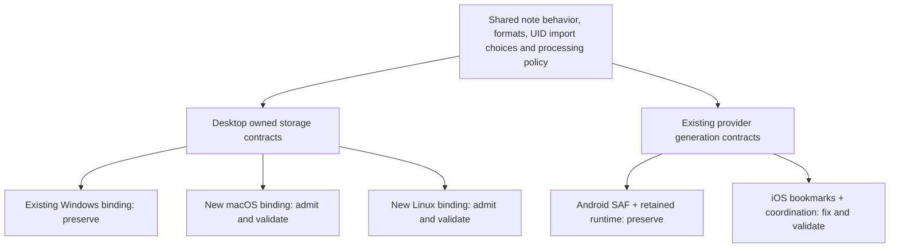

# Future Notes: four-platform gap analysis and proposed fixes

> Historical analysis baseline. Subsequent staged code changes and current validation/pending native gates are recorded in [implementation-status.md](implementation-status.md). The starting-state matrix and “no application code changed” statements below describe the analysis pass, not the later implementation.

Reviewed: **2026-10-21**. Targets: **macOS, Linux, Android, iOS**. Windows is the preservation baseline. Web is outside this requested four-target implementation proposal.

## Decision

**Full four-platform support cannot currently be claimed.** macOS/Linux use a weaker legacy application route and contain definite export/cache/native-preview gaps. Android has a working protected Preview and specific device evidence, but not the complete minimum/current API acceptance matrix. iOS has substantial native code, including a wired sharing extension, but a source-contract defect blocks first folder admission; Apple native artifacts and host/device acceptance are incomplete.

The right first implementation is **a reproducible toolchain and portable contract baseline, followed by native storage adapters**. Fix the iOS error-code mismatch as an isolated correction. Do not remove Windows guards, copy mobile provider assumptions into desktop paths, change encryption formats, or redesign accepted screens to make a build pass.

This deliverable is the requested breakdown and repair proposal. **No application code was changed for this analysis.** Ten distinct validation passes were completed against source, configuration, existing evidence and primary platform contracts. They are not ten native builds or ten successful runtime tests on every target, and do not add verification passes to normal file processing.

## Baseline and evidence limits

- Branch `development`, HEAD `a5be98cd520d501eb8f31e19bacb7bcd4cc8f4e6`, app `1.4.3+10`.
- Current source includes the existing uncommitted share/protection fix and other dirty work. Those changes were preserved and are not silently included in the release commit.
- Observed local SDK: Flutter **3.41.5**, revision `2c9eb20739dfec95e2c74bd3dfa4601b0a8a36aa`; Dart **3.11.3**. The lock requires Dart **>=3.11.0**, while `pubspec.yaml` advertises `^3.10.1`.
- Input: the user-provided `future-notes-multiplatform-gap-report.md`, produced by Codex on a Mac. Its 683 passed / 103 skipped / 192 failed totals and temporary tooltip compatibility adapter are **reported Mac evidence**. The exact audited commit, modified adapter diff and raw test event stream were not supplied. This review does not substitute those totals for a current unchanged-source Mac run.
- This review runs on Windows. Android API 31 is connected. Only `docker-desktop` is listed in WSL; no configured Linux desktop, Mac/Xcode or iOS device/simulator is available here. None was provisioned or launched.
- Existing Android evidence was inspected rather than rerun: protected candidate build, APK identity/ABI checks, 74 affected tests, and a 78,344,392-byte synthetic video shared from Android Files through password set/removal and previews with one unchanged app process. These are bounded workflow results, not whole-product certification.
- Existing user notes were not opened or hashed. No old release, APK, portable directory, tag or signing identity was changed. No commit/push/publication occurred.

Evidence terminology:

| Label | Meaning |
|---|---|
| Source-confirmed defect | Caller/configuration/native implementation disagree or explicitly reject the path. Runtime severity still has a stated host scope. |
| Implemented, host-unvalidated | Code and wiring are present; this does not prove native compilation or correct execution. |
| Workflow validated | A specific existing build/device/test artifact proves the stated scenario only. |
| Reported | Evidence supplied by the Mac audit; not reproduced here. |
| Proposed | A repair and its acceptance gate, not enabled product behavior. |

## Current support matrix

| Capability | macOS | Linux | Android | iOS |
|---|---|---|---|---|
| Canonical clean build | Not established; Mac report used older SDK + temporary adapter | Not established | Protected Preview build evidence present | Pending Mac/Xcode, native framework and signing gates |
| Normal application backend | Legacy desktop FileService | Legacy desktop FileService | Provider-backed mobile runtime | Provider-backed source; first admission blocked |
| Owned desktop recovery | Windows gates reject it | Windows gates reject it | Separate provider generation protocol | Separate provider source, unvalidated |
| Ordinary app-settings durability | Direct JSON fallback | Direct JSON fallback | Direct JSON fallback; native selection/drafts/jobs are separate | Same distinction |
| New selected-folder admission | New desktop adapter required | New desktop adapter required | Persisted SAF local/SD implementation and bounded device evidence | Definite `name_exists` mapping mismatch |
| Safe external publication | Both routes choose rejecting adapters | Both routes choose rejecting adapters | Native/provider paths implemented | Private POSIX/provider source; unvalidated |
| Private cache and file-based preview | Normal desktop actions/cache missing | Normal desktop actions/cache missing | Implemented; selected preview workflows validated | Native actions/cache source present; host pending |
| UID-first duplicate choices | Owned importer exists, but ordinary legacy startup bypasses it | Same | Shared owned importer used | Shared importer present behind admission blocker |
| Office preview | Wrong Windows default loader; native package missing | Wrong Windows default loader; native package missing | `.so` packaging and selected runtime evidence present | Recipe/podspec present; XCFramework absent here |
| PDF/media | Plugin implementations exist; storage/cache and host gates pending | Plugin implementations exist; system media dependencies and host gates pending | Selected formats tested on API 31 | Native build/render/lifecycle acceptance pending |
| Multi-file intake/batch actions | Shared controls/plugins alone do not pass native workflow gates | Same; locked plugin cannot share files on Linux | Accepted picker/selection/share flow has prior evidence | Native picker/share source exists; real iPhone/iPad pending |
| Background jobs | Process-owned desktop jobs; full port pending | Same | Retained owner + foreground dataSync service; OS limits apply | Finite UIKit background window; no scheduled BGTask runner |
| Library-change/resume hints | Owned watcher integration pending | Owned watcher integration pending | Native hints + metadata reconciliation | Shared listener is a no-op off Android |
| Host open/reveal/keyboard | Finder/cache adapter and Command primary actions missing | Open/reveal adapter missing; Control actions already appropriate | Touch/native actions present; broader keyboard/device gates pending | Touch/native source present; Apple keyboard and presentation pending |
| Release/distribution readiness | Signing, entitlements, sandbox access and native packages pending | Distro/package/media dependency and native integration gates pending | Protected Preview delivered; not production/store-wide certification | Not ready for a support/release claim |

Detailed evidence: [storage](storage-review.md), [data/mobile runtime](mobile-review.md), [toolchain/native packaging/tests](packaging-test-review.md), [baseline/host integration](host-integration-review.md).

## Ten validation passes

Each pass checked all four targets against its applicable route. “Complete” refers to the analysis, not to future native acceptance gates.

| Pass | Independent question and evidence | macOS result | Linux result | Android result | iOS result |
|---:|---|---|---|---|---|
| 1 | Is the baseline reproducible? Git/worktree, SDK/lock, Mac report provenance, connected-host inventory and existing artifacts | Report SDK differs; canonical run unproved | No configured desktop validation host | API 31 + protected candidate evidence present | No Apple build/device evidence |
| 2 | Which bootstrap, owner and settings writer actually execute? Full constructors and startup branches | Legacy by default; explicit owned startup fails closed | Same | Provider notes, ordinary settings still direct | Provider source; admission error mismatch |
| 3 | Can each publication route meet native move/collision semantics? Both export routes + native primitive contracts | Rejecting adapter; dedicated native binding needed | Rejecting adapter; filesystem capability needed | Preserve current private/provider routes | Preserve coordinated provider/fallback route; unvalidated |
| 4 | Will recovery/migration preserve identity and predecessor data? Journal decode, root/lease identity, case/alias and failure boundaries | Case/aliases/advisory locks require native admission | Locks/rename/fsync/packaging require native admission | Preserve SAF identities, provider-v2 guards and receipts | Preserve bookmarks/coordination; fix error typing first |
| 5 | Are formats, UID decisions, processing policy and cache semantics compatible? Import call order, cipher framing, receipts/defaults | Reuse shared codecs, but legacy route bypasses owned import/cache | Same | Compatible intended native/Dart format; bounded device evidence | Shared format and one encrypted-transfer fallback; no format change needed |
| 6 | Is job/share/lifecycle ownership actually integrated? Manifest, retained engine, Swift target/channel/extension/lifecycle | Desktop owner/actions still needed | Same | Retained owner and notifications implemented; min/current API gates remain | Extension wired; finite background time, no library event hook/native task notifications |
| 7 | Can locked dependencies and native artifacts be built/packaged on the intended host? SDK, Gradle, Xcode/Pods, Office/PDF/media inputs | SDK pin, native libraries, sandbox/build integration pending | Native libraries/system dependencies pending | Current toolchain meets plugin declarations; Office script is Windows-host-specific | Native Office artifact absent; Mac signing/link gates pending |
| 8 | Do tests prove cross-platform behavior? Defined textual recount, fixture constructors, target variants, CI inventory and Mac totals | Existing host assumptions prevent blanket inference | Same | Windows test target overrides do not validate Android | Same; Mac test totals do not prove iOS |
| 9 | Are host affordances/capacity/actions correct without changing designs? Actual UI gates and native runners | Command/reveal/folder grants missing; conservative capacity fallback exists | Reveal/open and Linux Share capability gaps | Preserve accepted touch design and native actions | Check iPad keyboard/presentation; preserve touch design |
| 10 | Do the proposed fixes survive independent challenge and preservation checks? Cross-review, source anchors, report claim corrections, artifact/dirty-file checks | No guard-only port or unproved clean-build claim | No generic POSIX/URL-launch/portable-bundle claim | No rewrite of accepted owner/cipher/UI | No Android-equivalence or source-ready-only claim |

Pass evidence is consolidated in `validation-ledger.json`. Future native tests are explicitly listed below; they have not been converted into passing results.

## Broken-down findings and fixes

### G01 — P0: reproducibility and Flutter API/lock mismatch

The current lock's Dart floor is incompatible with the Mac audit's older Dart environment. `AppTooltip` also requires the newer `RawTooltip` API (`lib/core/theme/app_tooltip.dart:21`). `pubspec.yaml` does not pin Flutter and understates the lock's Dart floor.

**Propose:** document and enforce the same exact accepted SDK/revision and lock on all build hosts, initially evaluating the observed 3.41.5 baseline. Align declared constraints deliberately. Do not upgrade/downgrade packages or leave a temporary tooltip adapter enabled to hide environment drift. If the available Mac cannot run the compatible Xcode/SDK combination, use an appropriate Mac build host; application runtime minimums and build-host requirements are different decisions. Verify the unchanged source/lock first.

### G02 — P0: desktop owned storage is Windows-gated

`main.dart:29`, `owned_app_services.dart:22`, `owned_note_persistence.dart:22`, `owned_settings_persistence.dart:16`, `recoverable_store.dart:129` and `storage_owner_worker.dart:109` select/restrict Windows. macOS/Linux normally write through legacy FileService. Explicit owned configuration fails closed rather than silently falling back.

**Propose:** preserve the Windows binding and extract only the host primitive/capability boundary needed by macOS/Linux. Reuse shared mutation/journal/codec behavior. Add separate admitted desktop bindings for root/file identity, cooperative ownership, no-replace moves, flush/directory persistence and typed errors. Keep mobile provider storage separate. Removing platform guards is not a repair.

### G03 — P0: macOS/Linux safe-export routing is broken

`external_file_export.dart:64` selects the mobile-only POSIX implementation off Windows; `posix_file_actions.dart:22` rejects desktop hosts. The checked route at `external_file_export.dart:160` instead selects Windows actions for macOS/Linux and is also rejected.

**Propose:** select admitted host actions explicitly in both routes. Retain same-volume candidates, destination conflict checks, predecessor retention, receipts and rollback. Do not turn an existence-check plus ordinary replacing rename into “no-replace,” use cross-volume copying as an atomic move, or force full-file verification on for a new port.

### G04 — P0: iOS rejects a successful capability-probe collision

The library probe accepts only the intended `name_exists` error (`library_admission_probe.dart:75-77`). Swift rejects a duplicate name but maps all errors to `native_document_failed` (`MobilePlatform.swift:70-73,325`). Both source reviews independently traced this through the Dart adapter and startup caller.

**Propose:** a typed Swift error map matching the existing Dart document contract. Do not weaken/bypass the probe or admit arbitrary generic errors as collisions. Gate first selection, switch, cleanup and restart on an actual iOS native build/device.

### G05 — P1: attachment opening depends on storage and native actions

The shared `AttachmentFileActions` interface already exists. The desktop screen only supplies Windows actions; cache initialization additionally requires owned mutations (`dashboard_screen.dart:182`, `content_viewmodel.dart:466`). A viewer/library build alone cannot fix normal macOS/Linux attachment opening.

**Propose:** macOS/Linux implementations of the existing actions contract, private owner-scoped cache roots and host-native opening/revocation. Preserve cache reuse and the accepted Windows source/session path. Then enable library switching/drop through existing capabilities and test real host interactions. Do not create another overlapping desktop-actions abstraction.

### G06 — P1: Office native resolution/packaging is incomplete

macOS/Linux currently select `office_oxide.dll`; iOS has its build recipe and podspec but no XCFramework in this tree. Android's pinned Office build recipe hardcodes the Windows NDK host toolchain. PDF already guards its Windows preload; it is not the same DLL-routing defect.

**Propose:** explicit host library resolution plus pinned native artifacts for each claimed CPU/host. Preserve C ABI, parser limits, HTML sanitization and accepted Windows DLL/Android packaging. Parameterize the Android Office build host without upgrading the crate. Build iOS device/simulator slices on Mac. Validate native dependency linking and all claimed document formats; external opening is not Office preview parity.

### G07 — P1: Linux native file handoff/media packaging need explicit contracts

Locked `share_plus` 12.0.1 does not support file sharing on Linux. Linux media depends on host mpv/epoxy; the existing runner/RPATH does not create a self-contained universal Linux package.

**Propose:** preserve batch selection but expose host-supported Save/export/open actions; add a Linux sharing integration only if its contract can actually be met. Use portal `OpenFile` for local descriptor handoff and versioned `OpenDirectory` for reveal where available. Define intended distro/package dependencies and test on a clean supported host. Do not claim Android share-sheet parity or require a dependency bump without evidence.

### G08 — P1: iOS runtime parity is narrower than Android

The ShareExtension target is embedded and connected to App Groups; it is not absent. However iOS library events are a no-op, jobs use finite UIKit background time, native task notifications are absent, and the shared expiration message names Android.

**Propose:** fix event/resume hints and timeout wording independently; retain one owner, cancellation/recovery, no persisted passwords and private drafts. Validate extension signing, large shares and expiration before claiming support. Decide separately whether an iOS-specific background task/notification capability is required and feasible; do not promise unlimited or Android-identical execution. Keep iOS's valid one encrypted-transfer fallback until a coordinated owned sink is proved.

### G09 — P1: ordinary settings do not have the implied mobile recovery model

Without the desktop-owned settings owner, `SettingsService._saveSettings` directly replaces JSON. This includes mobile ordinary settings; native library selection, draft and job ledgers are separate. Some setting failures are swallowed, while performance-setting failures rethrow.

**Propose:** a separately scoped recoverable settings publication path using each host's appropriate private storage contract. Preserve current location, unknown metadata, explicit saved verification choices and truthful failure/rollback behavior. Do not route mobile libraries through desktop ownership as a side effect.

### G10 — P1: tests and CI cannot establish parity yet

The Mac audit's textual patterns reproduce: **64 Windows skip expressions**, **7 Windows target-variant expressions**, **32 `D:/` literals across 11 files**. These are not exact registered-test counts. No tracked CI configuration was found. Mac totals are attributed observations with cascaded constructor/toolchain failures, not 192 independently established product defects.

**Propose:** portable behavioral/codec/journal fixtures and separate actual-host primitive suites. Convert filesystem fixtures to canonical owned temporary roots; retain intentional Windows path tests. Capture machine-readable events and first failing boundary per test. Run one combined affected suite after each coherent implementation change; ten reruns of one Windows suite do not establish four-platform compatibility.

### G11 — P1/P2: host actions, keyboard and distribution configuration

macOS primary actions use Control instead of Command; Finder/Linux reveal is missing; desktop library controls can fail late. macOS is sandboxed without selected-file/bookmark configuration, identities remain example values, and Linux runner titles are template-like. Linux already has relative RPATH; macOS already has sandbox defaults. It is inaccurate to describe either as no platform protection at all.

**Propose:** capability-based availability, correct primary modifiers and narrow native reveal actions without visual redesign. Add appropriate scoped permissions/signing/notarization or Linux package controls for the chosen distribution. Review identity/location migration before renaming bundles. Keep native macOS/Linux window chrome; do not port the Windows frame/tray literally. The dormant tray setting requires a separate product decision, not automatic feature expansion.

#### macOS permission requests and persistent folder access

This is an explicit part of G11 and stages C–F, including the user-requested permission flow. Current Debug/Profile and Release entitlements have neither user-selected read-only nor read-write file access. The locked `file_picker` 10.3.7 macOS implementation checks those entitlements **before** presenting its folder panel (`FilePickerPlugin.swift:143-149,223-240`); without either, it returns `ENTITLEMENT_NOT_FOUND`. Its directory result is a plain path (`:171-172`), which does not implement this application's persistent bookmark ownership. These are source-confirmed gaps, not Mac runtime results.

Proposed behavior:

- Request access when the user chooses a library, adds/imports files or saves an export, through native Open/Save panels. Require writable access for a live library/export destination; retain only the access needed for input files. Do not show unrelated permission requests at startup.
- Configure user-selected read/write access and app-scoped bookmark support for the sandboxed distribution in Debug/Profile and Release. Retain existing debug exceptions. Entitlements permit the operation; they do not themselves present a consent dialog. [Apple entitlement guidance](https://developer.apple.com/library/archive/documentation/Miscellaneous/Reference/EntitlementKeyReference/Chapters/EnablingAppSandbox.html).
- Let the macOS storage adapter own selected URLs and persistent security-scoped bookmark data. On restart, resolve the bookmark, handle stale data and activate scoped access before library I/O. Refresh a stale bookmark when resolution/access still succeeds; otherwise offer a user-initiated **Grant folder access** / folder reselection action. A saved path alone is not permission. [Apple sandbox file-access contract](https://developer.apple.com/documentation/security/accessing-files-from-the-macos-app-sandbox).
- Keep access alive for the owning library/job through reads, writes, publication and cancellation cleanup. Balance acquired security-scope access after the owner finishes; picker/dialog dismissal must not invalidate an active background job. The app's private container/cache remains separately owned. [Scoped-resource lifetime](https://developer.apple.com/documentation/foundation/nsurl/startaccessingsecurityscopedresource()).
- On cancellation, denial, stale/revoked access or removed storage, retain the current library selection, unsaved draft and recoverable transaction material. Distinguish a missing build entitlement from user-denied access. Do not silently switch folders, retry permission prompts in a loop or report an unavailable library as empty.
- Treat macOS privacy controls as a separate OS-controlled layer when applicable. Normal selected-file workflows should use their scoped grants; do not add a blanket Full Disk Access requirement or request microphone/camera access merely to preview existing media.

**Mac acceptance:** clean signed Debug and Release candidates; first selection and cancellation; writable library selection vs read-only input; export-save cancellation; app restart with restored access; moved/stale bookmark; denied/revoked access and volume removal; reselection without losing a draft; background work continuing after its panel closes; balanced scope release after completion/cancel. These native permission gates remain pending a Mac. No app permission code or entitlement was changed by this planning update.

### G12 — P2: macOS performance telemetry is absent, but fallback exists

`system_capacity.dart:86-89` has Windows/Linux probes and mobile inputs, no macOS sampler. `attachment_scheduler.dart:42-46` already uses one worker when capacity is unknown.

**Propose:** retain that conservative path and 70% scheduling semantics; add macOS native telemetry only after the storage path works and host measurements justify it. Treat this as performance/observability work, not a blocker solved by lifting worker limits.

### G13 — Separate shared concern: completed recovery may still read retained payloads

`recoverable_store.dart:620-634` verifies retained baselines, and `_verifyBaseline` at `:770-799` calls payload revision capture even for completed records. Therefore default-off optional switches do not prove that every clean startup avoids payload scans.

**Propose:** measure and design a bounded completed-record trust/identity strategy separately while preserving ambiguous-transaction recovery and predecessor integrity. Do not blindly remove recovery verification or add new normal-job scans as part of the Mac/Linux port. This is an observed existing behavior, not a new scan introduced by this analysis.

## Proposed implementation sequence

| Stage | Scope and prerequisites | What must remain unchanged | Required evidence before enabling |
|---|---|---|---|
| A | Record exact SDK/lock/host manifests; resolve RawTooltip/lock mismatch; make affected test fixtures portable | Dependencies, editor visuals, release artifacts, all existing data | Unchanged source resolves/builds on chosen toolchains; affected tests have meaningful host classification |
| B | Isolated iOS typed document-error correction | Admission strictness, bookmarks, library/draft selection, Android native behavior | Native error contract test + actual first selection/collision/failure/switch/restart on iOS |
| C | Add minimal desktop capability bindings and macOS/Linux primitives/root admission, including macOS native permission requests and scoped URL ownership; reuse shared contracts | Existing Windows implementation; mobile provider routes; byte/encryption/journal compatibility | Actual-host permission/identity/ownership, collision/no-replace, supported filesystem and interruption/recovery gates |
| D | Bootstrap the admitted desktop owner/settings; preserve legacy locations and migration/rollback | IDs, mention IDs, whitespace, timestamps, unknown metadata, existing directories | Legacy/completed/pending corpus opens safely, failures retain old state; library/settings switch and restart gates |
| E | Supply private native actions/cache, then enable attachments/import/export/drop and native open/reveal | Accepted Windows cache behavior; UID choices before extraction; optional checks off | Each viewer, cache reuse/lock teardown, batch actions, safe export/import and real filesystem failures on each new host |
| F | Package pinned Office/PDF/media, then finish host keyboard/sandbox/distribution details and iOS lifecycle gaps | ABI/parser limits, native dependency versions, established mobile/desktop designs | Clean signed/packaged host builds, native ABI/slices/dependencies, min/current OS and actual UI/runtime gates |
| G | Address separate settings/recovery-scan/telemetry concerns in bounded changes | Recovery predecessors, fast defaults, source ownership, capacity/cancellation rules | Measured failure/latency/resource outcomes with no hidden extra payload passes |

Stages are a proposal, not authorization to modify application behavior now. macOS and Linux bindings can be developed independently after the shared contract is reviewed; neither should silently select an unvalidated writer. Android/iOS keep separate native lifetime and folder-access implementations.

## Preservation and acceptance requirements

Before each executable change, identify affected platforms, retain accepted artifacts and record the exact patch. Keep source/backend adapters and platform UI separate. Run formatting, scoped analysis, one combined affected regression suite and the affected native build once per coherent change. A shared change needs Windows/Android compatibility evidence as well as the new host's evidence. Do not replace a stable artifact after a failed required gate.

All platform corpora must be synthetic and include:

- Save/reopen, autosave failure, existing/protected/new drafts and recovery without automatic publication; note switching/IME/selection/undo and immediate lock teardown.
- Current/legacy library layouts and journal versions; UID/mention IDs, unknown metadata, body whitespace/timestamps and Android ↔ desktop 1.4.1/current packages, archive-password variants and duplicate/replace/ignore.
- Admission/ownership aliases and concurrent cooperating owners; interruption at each publication boundary; short writes/full storage, changed sources, denied/revoked access, removed storage and retained ambiguity.
- Attachment-first publication and predecessor backup, default-off verification and explicit opt-in; payload counters distinguish transform from necessary encrypted transfer. Ignore extracts zero attachment payloads. No redundant full-file pass is added to product runtime.
- All supported image/GIF/audio/video/PDF/Office previews, cache reopening, private-cache orphan cleanup/revocation and external-app access limits. A platform cannot revoke copies another app has already taken.
- Batch picking/selection/native Save/Share/open equivalents, cancellation and retained results; background-job notification/recovery/expiry on the relevant OS.

Platform gates:

| Platform | Native acceptance required before claiming support |
|---|---|
| macOS | Intel/Apple Silicon artifacts where claimed; chosen OS/Xcode/SDK; actual default and case-sensitive APFS where supported; native permission request/cancel/denial, persisted bookmark/relaunch, stale/revoked access and scope lifetime; signing/native linking; Finder/default-app/Command/window/IME and recovery workflows |
| Linux | Named distro/ABI/package on a real GUI host; filesystem/no-replace/lock/fsync semantics; GTK and X11/Wayland/portal paths; clean media/native dependencies; native open/reveal/save and recovery workflows |
| Android | API 24 minimum, connected API 31, current intended target; ABIs/page sizes/signing/private symbols; cold/warm file shares, foreground restrictions, permission denial, cancel/timeout/process death/recovery, SD removal and sustained large files |
| iOS | Compatible Mac/Xcode; device + simulator native slices; iOS 13 and current intended devices/iPad; signing/App Groups; folder admission/bookmarks/coordinated writes, extension constraints, UIKit expiration, native save/share, Keychain/drafts/snapshot cover and lock teardown |

The current Flutter [platform support page](https://docs.flutter.dev/reference/supported-platforms) describes a newer SDK. It is not permission to silently raise this project's iOS minimum. The selected SDK, plugin and binary floors must be checked together. Apple also separates [Xcode host, deployment and device requirements](https://developer.apple.com/xcode/system-requirements).

## What is complete now

The breakdown, proposed corrections, ten-pass source/configuration/contract review, support classification and future host gates are complete. The analysis validates that the listed defects/limits are grounded in the inspected state; it does not validate repairs that have not been implemented. No new Mac/Linux/iOS support is claimed. Implementation and native host/device acceptance remain future work.

Review evidence and preservation results: `validation-ledger.json` and `analysis-validation.json`. Detailed reviews contain the source references and primary documentation behind each finding.
